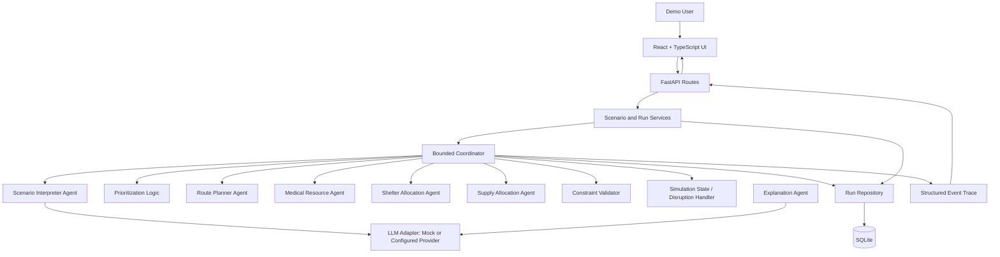
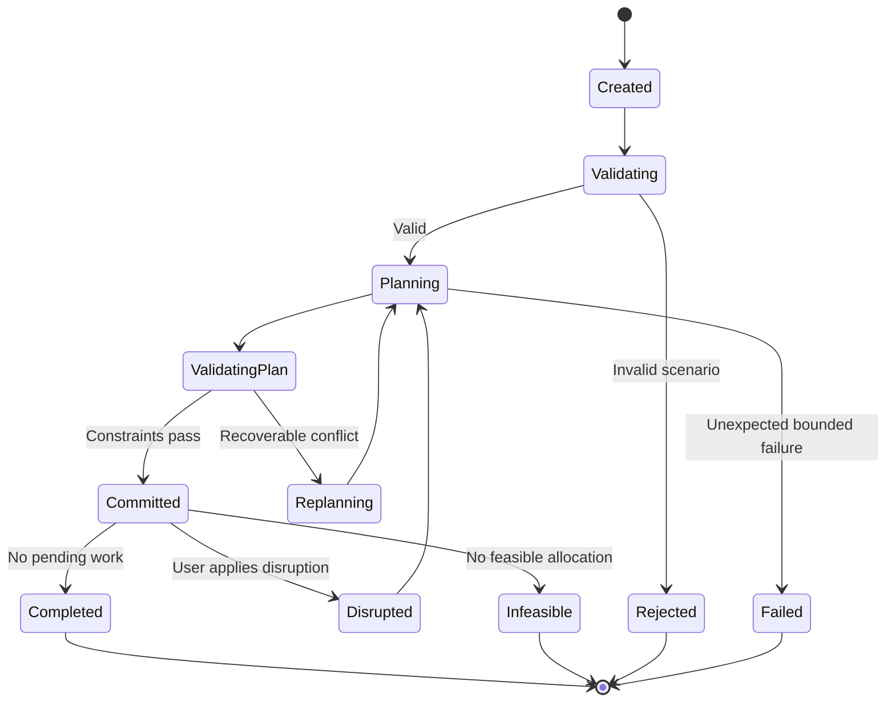

# Architecture Specification

## 1. Overview

RescueSwarm is a local-first, single-user educational web app. The frontend communicates with a FastAPI backend. The backend validates scenario data, coordinates specialist agents, applies deterministic simulation rules, stores event traces in SQLite, and optionally calls an LLM through a provider adapter for two bounded functions: natural-language scenario extraction and run explanation.

## 2. Logical topology



## 3. Component responsibilities

### Frontend

- Scenario gallery/editor and plain-language entry.
- Structured preview and validation feedback before a parsed scenario is accepted.
- Run controls, synthetic graph rendering, resource/incident status, event trace, and metrics.
- Disruption controls such as close/reopen edge or reduce capacity.
- Baseline comparison and JSON/CSV export.
- Visible simulation-only disclaimer and indicator of mock/provider LLM mode.

### API layer

- Defines request/response schemas and stable HTTP status codes.
- Validates limits before invoking services.
- Does not contain orchestration or algorithm logic.
- Exposes health/readiness endpoints without leaking environment variables or secrets.

### Scenario service

- Loads bundled JSON scenarios, validates user-created scenarios, normalizes defaults, and assigns IDs.
- Does not treat free text as a trusted scenario object.

### Coordinator

- Owns run state and a finite execution loop.
- Invokes specialist agents in a documented order, validates intermediate output, updates state, and appends events.
- Stops on completion, infeasibility, a repeated no-op state, an error policy, or max step count.

### Specialist agents and deterministic services

- Scenario Interpreter: optional LLM-assisted text-to-structure conversion with schema validation and user review.
- Prioritization: deterministic urgency score; not delegated to an LLM.
- Route Planner: NetworkX shortest path over available weighted edges.
- Medical Dispatch: allocates finite vehicles to prioritized incidents using distance, eligibility, and availability.
- Shelter Allocator: assigns simulated affected-person counts to shelters with capacity constraints.
- Supply Allocator: allocates finite aid kits to demand nodes with capacity and inventory checks.
- Constraint Validator: verifies every proposed allocation before the state changes.
- Explanation Agent: summarizes already-recorded structured facts; cannot change the plan.

### Persistence

SQLite stores scenarios, run summaries, events, and metric snapshots. Store a seed and algorithm version with each run. For the MVP, a run is an immutable experiment record; rerunning creates a new record rather than overwriting past results.

## 4. Proposed source layout

```text
frontend/
  src/
    app/
    components/
    features/scenarios/
    features/runs/
    features/agents/
    lib/api/
    styles/
backend/
  app/
    main.py
    api/routes/
    schemas/
    services/
    agents/
    simulation/
    algorithms/
    repositories/
    llm/
    core/
  tests/
  scenarios/
```

The exact files can vary, but preserve the responsibilities and dependencies. Prefer dependency direction: routes → services → coordinator/algorithms/repositories; agents must not import routes.

## 5. Run lifecycle



All states and allowed transitions must be implemented explicitly. `Replanning` must remain bounded.

## 6. Authentication and trust boundaries

No user accounts or authentication are required for the local classroom MVP. Do not expose the server to an untrusted public network with this assumption. Keep the API bound to localhost by default in development. Validate CORS origins from configuration. Any public deployment must be treated as a separate decision and must include an updated threat model and access-control design.

Trust boundaries include browser → API, API → LLM provider, persisted scenario files → parser, and LLM output → typed application state. Validate at each boundary.

## 7. API and data flow

- Frontend posts a scenario draft; backend validates and returns normalized scenario data.
- For natural-language input, backend returns a proposed structured scenario plus `needs_review`; frontend requires review/confirmation.
- Run endpoint creates a run record and returns run summary plus an event trace. For MVP, synchronous execution is acceptable for small scenarios. If a run becomes too slow, add polling only through an approved decision.
- Disruption endpoint adds a typed disruption to a run and requests a new bounded planning cycle.
- Run detail endpoint returns persisted state, events, metrics, and mode metadata.
- Export endpoints return a stable JSON or CSV representation.

## 8. LLM topology

`LLMProvider` should expose narrow methods such as `parse_scenario(text, constraints)` and `explain_run(structured_run_summary)`. The implementation can select mock or configured provider from environment. The key is server-side only. Prompts and responses should be size-limited, time-limited, validated, and logged in redacted form. Do not send personally identifiable or real emergency information because the product uses synthetic data only.

## 9. Observability

Each run event should include `event_id`, `run_id`, sequence number, timestamp, actor, event type, input/output summary, status, and safe reason code. Avoid saving chain-of-thought or hidden reasoning. Log actions and evidence summaries rather than private internal reasoning. Metrics should be computed by deterministic code from the committed simulation state.

## 10. Capacity and performance assumptions

The initial scenario caps are in `prd.md`. The MVP is not a real-time system. Keep algorithm execution synchronous and under a few seconds for the bundled scenarios in a normal development laptop, but measure rather than promise performance. LLM response time is variable and should have a timeout plus a graceful mock/explanation fallback.
