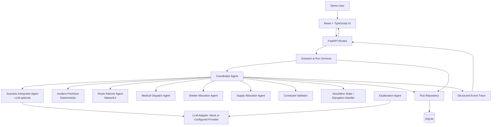

# Design Document — RescueSwarm

> F0003 CA2/CA3 · Agentic AI Course

## 1. Architecture Diagram

All nine agents are labeled; every connection and data-flow direction is shown.

## 2. Agent Roles and Responsibilities

| Agent | Role | Responsibility |
|---|---|---|
| **Coordinator Agent** | Orchestrator | Owns the run lifecycle; invokes specialist agents in bounded iteration; validates proposals; commits state; triggers replanning after disruptions |
| **Scenario Interpreter** | Worker | Converts user free-text into a proposed typed scenario schema using LLM structured extraction; always returns `needs_review=true`; mock parser works without API key |
| **Incident Prioritizer** | Worker | Computes a deterministic urgency score for each incident: `0.40×urgency + 0.25×people_affected_norm + 0.20×time_sensitivity + 0.15×access_risk`; tie-broken by creation order |
| **Route Planner Agent** | Worker | NetworkX shortest-path over available weighted edges; closed edges excluded; returns path node IDs, cost, or `infeasible` |
| **Medical Dispatch Agent** | Worker | Greedy allocation of finite simulated ambulances to prioritized incidents; scores candidates by incident priority then route cost; proposes assignments without exceeding availability |
| **Shelter Allocation Agent** | Worker | Allocates synthetic displaced-person counts to shelters with capacity constraints; respects `allow_shelter_split` flag |
| **Supply Allocation Agent** | Worker | Allocates finite aid kits to demand nodes using nearest-available-stock policy; records unmet demand separately |
| **Constraint Validator** | Gatekeeper | Verifies every proposed allocation against capacity, route availability, and assignment invariants before state mutation; rejects with typed reason codes |
| **Explanation Agent** | Reporter | Summarizes committed run facts in plain language using a template or optional LLM call; cannot modify the plan |

## 3. Orchestration Pattern: Orchestrator-Worker

**Named pattern:** Orchestrator-Worker (also described as a Bounded State Machine)

**Justification:** The Coordinator acts as the single authority for state mutation and run termination. Specialist agents propose actions; they do not commit state directly. This separation ensures that constraint enforcement is centralised and auditable. An orchestrator pattern was chosen over peer-to-peer because the constraint validator must see every proposed action before it is applied, and replanning must be bounded (MAX_COORDINATOR_STEPS) to prevent infinite loops. A blackboard pattern was considered but rejected because shared mutable state without a gatekeeper makes constraint enforcement harder to test and reason about.

The loop terminates when: all pending incidents are resolved OR no feasible action remains OR state signature repeats (no-progress detection) OR MAX_COORDINATOR_STEPS is reached.

## 4. Technology and Framework Choices

| Technology | Justification |
|---|---|
| **Python 3.12+ / FastAPI** | Typed, async-capable HTTP framework; Pydantic v2 for schema validation at all trust boundaries; widely used in agentic AI coursework |
| **NetworkX** | Mature graph library for shortest-path routing; deterministic output; no external service dependency |
| **SQLite + SQLAlchemy** | Zero-configuration persistence; reproducible experiment records; appropriate for single-user local demo |
| **React 19 + TypeScript** | Strong typing for UI state; component model fits the multi-panel (graph, events, metrics, compare) layout; Vite 8 for fast local dev |
| **Pydantic v2** | Runtime schema validation for all agent inputs, outputs, and LLM responses; ensures LLM output is validated before use |
| **Mock LLM mode** | Default at runtime; allows full demonstration without API keys or internet connectivity; satisfies offline classroom requirement |
| **httpx (optional)** | Used only when `LLM_PROVIDER` is not `mock` and a key is locally configured; never required for the demo |

## 5. Consistency Check

This document describes the system as actually deployed. The source layout (`backend/app/agents/`, `backend/app/algorithms/`, `backend/app/simulation/`, `frontend/src/features/`) matches the architecture specification in `architecture.md`. Agent names in this document correspond to `Actor` enum values in `backend/app/schemas/enums.py` and event records in `backend/artifacts/demo_run_export.json`.
